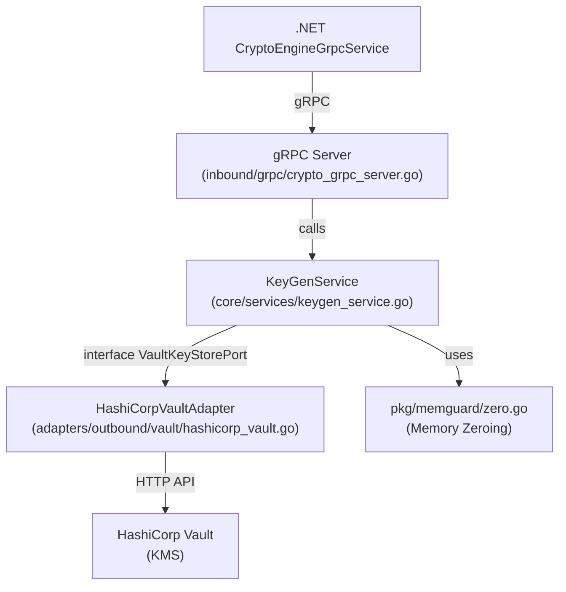

# KẾ HOẠCH TRIỂN KHAI (IMPLEMENTATION PLAN)
## XÂY DỰNG GO CRYPTO ENGINE - gRPC SERVER (KeyGen Phase)

---

## 1. Metadata
* **Mã Kế Hoạch:** `PLAN-2026-11-18-CRYPTO-ENGINE-PHASE1`
* **File Kế Hoạch:** `docs/plans/active/2026-11-18-crypto-engine-phase1.md`
* **Trạng Thái Hiện Tại:** `PENDING_APPROVAL` *(Chờ Người Dùng Phê Duyệt)*
* **Phạm Vi Tác Động:**
  - `src/crypto-engine/` (toàn bộ - khởi tạo và triển khai từ đầu)
  - `src/management/test/QuickSign.Infrastructure.Tests/` (thêm project .NET integration test giao tiếp gRPC với Go)

---

## 2. Mục Tiêu & Bối Cảnh (Goal Description)

### Hiện Trạng
* **Go Crypto Engine (`src/crypto-engine`)** hiện tại là thư mục trống.
* Phía **.NET** (`QuickSign.Infrastructure`) đã có sẵn:
  - File proto `crypto_engine.proto` (`src/management/src/QuickSign.Infrastructure/Cryptography/Protos/crypto_engine.proto`) định nghĩa đầy đủ 2 RPC: `GenerateCertificateKeyPair` và `DeleteCertificateKeyPair`.
  - gRPC Client `CryptoEngineGrpcService.cs` (`src/management/src/QuickSign.Infrastructure/Cryptography/CryptoEngineGrpcService.cs`) với Polly retry + Compensating Transaction.
  - `CertificateAppService.cs` orchestrate đầy đủ flow `gRPC → Domain → Repo → DB`.
* **Vault, PostgreSQL, Redis** đã được cấu hình trong môi trường phát triển (`appsettings.Development.json`).

### Phạm Vi Deliverable của kế hoạch này
Triển khai **Go Crypto Engine - Phase 1: gRPC Server (KeyGen)**, bao gồm:

1. **gRPC Server Go** thực thi đúng proto contract `crypto_engine.proto`:
   - `GenerateCertificateKeyPair`: Sinh cặp khóa RSA-2048 / ECDSA-P256, tạo chứng thư X.509, lưu Private Key vào HashiCorp Vault, trả về `serial_number`, `public_key_pem`, `vault_key_path`.
   - `DeleteCertificateKeyPair`: Xóa Private Key khỏi Vault (Compensating Transaction).
2. **Unit Tests (Go)**: Kiểm thử toàn bộ logic `KeyGenService` với Mock Vault (không cần Vault thật).
3. **Integration Tests (Go)**: Kiểm thử `gRPC Handler` → `KeyGenService` → `HashiCorpVaultAdapter` với Vault thật (đọc từ biến môi trường `VAULT_ADDR`).
4. **Integration Test (.NET)**: Chạy Go gRPC server thật trong test, kiểm thử `CryptoEngineGrpcService.cs` end-to-end.

---

## 3. Yêu Cầu Người Dùng Phê Duyệt (User Review Required)

> [!IMPORTANT]
> **Chiến lược bảo mật Vault Path:** Theo kiến trúc, Private Key lưu tại `secret/data/quicksign/users/{user_id}/keys/{certificate_id}`. Trong integration test Vault thật, dùng path prefix `secret/data/quicksign-test/` để hoàn toàn tách biệt dữ liệu production.

> [!NOTE]
> **Tuân thủ ADR 0001 - Memory Zeroing:** Golang thực hiện xóa byte Private Key khỏi RAM sau khi dùng bằng utility `pkg/memguard/zero.go` để ngăn chặn rò rỉ bộ nhớ.

> [!WARNING]
> **Go integration test cần kết nối đến Vault**. Test sẽ tự động skip nếu không có biến môi trường `VAULT_ADDR` hoặc không thể kết nối.

---

## 4. Kiến Trúc Go Crypto Engine (Hexagonal Architecture)



---

## 5. Cấu Trúc Thư Mục Sẽ Tạo

```
src/crypto-engine/
├── cmd/
│   └── server/
│       └── main.go                           # DI wiring, khởi tạo gRPC server
├── internal/
│   ├── config/
│   │   └── config.go                         # Load ENV vars (Vault, gRPC port, DB)
│   ├── core/
│   │   ├── domain/
│   │   │   └── keypair.go                    # Struct: KeyPair, CertificateMetadata, KeyAlgorithm
│   │   ├── ports/
│   │   │   ├── inbound.go                    # Interface: KeyGenerationUseCase
│   │   │   └── outbound.go                   # Interface: VaultKeyStorePort
│   │   └── services/
│   │       └── keygen_service.go             # Implementation: generate RSA/ECDSA, build X.509, vault store, zeroing
│   └── adapters/
│       ├── inbound/
│       │   └── grpc/
│       │       └── crypto_grpc_server.go     # gRPC handler: GenerateCertificateKeyPair + DeleteCertificateKeyPair
│       └── outbound/
│           └── vault/
│               └── hashicorp_vault.go        # HashiCorpVaultAdapter: HTTP call to Vault KV v2 API
├── pkg/
│   └── memguard/
│       └── zero.go                           # Memory zeroing utility (ADR 0001 §3)
├── proto/
│   └── crypto_engine.proto                   # Copy từ .NET (source of truth)
├── pb/                                       # Auto-generated từ protoc (go_package = "quicksign/crypto/pb")
│   ├── crypto_engine.pb.go
│   └── crypto_engine_grpc.pb.go
├── tests/
│   ├── unit/
│   │   └── keygen_service_test.go            # Unit tests: mock VaultKeyStorePort
│   └── integration/
│       ├── vault_integration_test.go         # Integration test: real Vault
│       └── grpc_integration_test.go          # Integration test: gRPC handler → real Vault
└── go.mod
```

---

## 6. Chi Tiết Các Thay Đổi (Proposed Changes)

### Component 1: Proto & Generated Code

#### [NEW] `src/crypto-engine/proto/crypto_engine.proto`
Đồng bộ từ `.NET` với `go_package`:
```proto
syntax = "proto3";
package quicksign.crypto;
option go_package = "quicksign/crypto/pb";

service CryptoEngineService {
  rpc GenerateCertificateKeyPair (GenerateKeyRequest) returns (GenerateKeyResponse);
  rpc DeleteCertificateKeyPair (DeleteKeyRequest) returns (DeleteKeyResponse);
}

message GenerateKeyRequest {
  string certificate_id = 1;
  string user_id = 2;
  string subject_name = 3;
  string algorithm = 4;
  int64 valid_from_unix = 5;
  int64 expires_at_unix = 6;
}

message GenerateKeyResponse {
  bool success = 1;
  string serial_number = 2;
  string public_key_pem = 3;
  string vault_key_path = 4;
  string error_message = 5;
}

message DeleteKeyRequest {
  string vault_key_path = 1;
}

message DeleteKeyResponse {
  bool success = 1;
  string message = 2;
}
```

---

### Component 2: Domain & Ports

#### [NEW] `internal/core/domain/keypair.go`
```go
// KeyAlgorithm enumerates supported asymmetric algorithms.
type KeyAlgorithm string
const (
    AlgorithmRSA2048   KeyAlgorithm = "RSA-2048"
    AlgorithmECDSAP256 KeyAlgorithm = "ECDSA-P256"
)

// GeneratedKeyPairResult holds the output of key generation returned to .NET.
type GeneratedKeyPairResult struct {
    SerialNumber string
    PublicKeyPEM string
    VaultKeyPath string
}
```

#### [NEW] `internal/core/ports/inbound.go`
```go
// KeyGenerationUseCase is the inbound port for all key lifecycle operations.
type KeyGenerationUseCase interface {
    GenerateKeyPair(ctx context.Context, req GenerateKeyPairRequest) (*domain.GeneratedKeyPairResult, error)
    DeleteKeyPair(ctx context.Context, vaultKeyPath string) error
}
```

#### [NEW] `internal/core/ports/outbound.go`
```go
// VaultKeyStorePort is the outbound port for secure private key storage.
type VaultKeyStorePort interface {
    StorePrivateKey(ctx context.Context, path string, pemBytes []byte) error
    DeletePrivateKey(ctx context.Context, path string) error
}
```

---

### Component 3: Core Service (Business Logic)

#### [NEW] `internal/core/services/keygen_service.go`
Logic chính theo ADR 0001:
1. **GenerateKeyPair:**
   - Dựa trên `algorithm` → gọi `crypto/rsa.GenerateKey(2048)` hoặc `crypto/elliptic.P256` / `ecdsa.GenerateKey`.
   - Tạo X.509 Certificate: Điền `Subject.CommonName = subjectName`, `SerialNumber`, `NotBefore = validFrom`, `NotAfter = expiresAt`.
   - Encode Private Key thành PKCS#8 PEM, Public Key / Certificate thành PEM.
   - Gọi `VaultKeyStorePort.StorePrivateKey(path, privateKeyPEM)`.
   - **Memory Zeroing:** Gọi `memguard.ZeroBytes(privateKeyPEMBytes)` (theo ADR 0001 §3).
   - Trả về `GeneratedKeyPairResult` (SerialNumber, PublicKeyPEM, VaultKeyPath).
2. **DeleteKeyPair:**
   - Gọi `VaultKeyStorePort.DeletePrivateKey(vaultKeyPath)`.

---

### Component 4: Vault Adapter

#### [NEW] `internal/adapters/outbound/vault/hashicorp_vault.go`
Giao tiếp với Vault KV v2 qua HTTP API:
- `StorePrivateKey`: Ghi vào KV v2 `secret/data/{path}` với payload `{ "data": { "pem": "..." } }`.
- `DeletePrivateKey`: Xóa metadata/data tại `secret/metadata/{path}`.

---

### Component 5: gRPC Inbound Adapter

#### [NEW] `internal/adapters/inbound/grpc/crypto_grpc_server.go`
Thực thi interface do `protoc-gen-go-grpc` sinh ra:
- `GenerateCertificateKeyPair`: Đọc `GenerateKeyRequest`, gọi `KeyGenService.GenerateKeyPair`, trả về `GenerateKeyResponse`.
- `DeleteCertificateKeyPair`: Đọc `DeleteKeyRequest`, gọi `KeyGenService.DeleteKeyPair`, trả về `DeleteKeyResponse`.

---

### Component 6: Memory Guard

#### [NEW] `pkg/memguard/zero.go`
```go
// ZeroBytes overwrites a byte slice with zeros to prevent private key leakage in RAM.
// Must be called with defer immediately after allocating sensitive key material.
func ZeroBytes(b []byte) {
    for i := range b {
        b[i] = 0
    }
}
```

---

### Component 7: Unit Tests (Go)

#### [NEW] `tests/unit/keygen_service_test.go`
Dùng mock implementation của `VaultKeyStorePort` để test `KeyGenService` không cần mạng:

| Test Case | Mô tả |
|:--- |:--- |
| `TestGenerateKeyPair_RSA2048_Success` | Sinh khóa RSA-2048, mock Vault nhận PEM, kiểm tra SerialNumber/PublicKeyPEM hợp lệ |
| `TestGenerateKeyPair_ECDSAP256_Success` | Sinh khóa ECDSA-P256, kiểm tra Certificate Public Key thuộc đúng curve P-256 |
| `TestGenerateKeyPair_VaultError_ReturnsError` | Vault mock trả về lỗi, kiểm tra error được propagate đúng |
| `TestDeleteKeyPair_Success` | Mock Vault nhận lệnh xóa, kiểm tra không có lỗi |
| `TestMemoryZeroing_PrivateKeyCleared` | Kiểm tra `ZeroBytes` ghi đè 0 lên toàn bộ byte slice |
| `TestGenerateKeyPair_InvalidAlgorithm_ReturnsError` | Thuật toán không hợp lệ trả về error rõ ràng |
| `TestX509Certificate_ValidMetadata` | X.509 cert có đúng CN, NotBefore, NotAfter, SerialNumber dương |

---

### Component 8: Integration Tests (Go - Vault thật)

#### [NEW] `tests/integration/vault_integration_test.go`
Kiểm thử trực tiếp với HashiCorp Vault:
| Test Case | Mô tả |
|:--- |:--- |
| `TestVaultAdapter_StoreAndDelete_Integration` | Lưu Private Key PEM vào Vault test path → đọc lại → xác nhận khớp → xóa |
| `TestVaultAdapter_DeleteNonExistent_NoError` | Xóa path không tồn tại không gây panic |

#### [NEW] `tests/integration/grpc_integration_test.go`
Chạy in-process gRPC server (`bufconn`), kết nối Vault thật:
| Test Case | Mô tả |
|:--- |:--- |
| `TestGrpcServer_GenerateKeyPair_RSA2048_Integration` | Gọi gRPC GenerateCertificateKeyPair → kiểm tra SerialNumber, PublicKeyPEM hợp lệ → dọn dẹp Vault |
| `TestGrpcServer_GenerateKeyPair_ECDSA256_Integration` | Gọi với algorithm ECDSA-P256, xác thực Public Key hợp lệ |
| `TestGrpcServer_DeleteKeyPair_Integration` | Tạo key → xóa qua gRPC → xác nhận Vault không còn key |
| `TestGrpcServer_CompensatingTransaction_Flow` | Giả lập flow: generate → delete (compensating), kiểm tra không còn orphan key |

---

### Component 9: Integration Test (.NET)

Thêm project test mới trong .NET solution để kiểm thử `CryptoEngineGrpcService.cs` giao tiếp với Go server:

#### [NEW] `src/management/test/QuickSign.Infrastructure.Tests/QuickSign.Infrastructure.Tests.csproj`
#### [NEW] `src/management/test/QuickSign.Infrastructure.Tests/CryptoEngineGrpcServiceIntegrationTests.cs`

| Test Case | Mô tả |
|:--- |:--- |
| `GenerateCertificateKeyPairAsync_WithRealGoServer_ReturnsValidKeyMaterial` | Gọi `CryptoEngineGrpcService.GenerateCertificateKeyPairAsync`, kiểm tra `SerialNumber`, `PublicKeyPem`, `VaultKeyPath` không rỗng |
| `GenerateCertificateKeyPairAsync_UnavailableServer_ThrowsServiceUnavailableException` | Không có server → Polly retry 3 lần → `BusinessException(ServiceUnavailable)` |
| `DeleteCertificateKeyPairAsync_WithRealGoServer_ReturnsTrue` | Tạo key → xóa → `true` |

---

## 7. Môi Trường & Cấu Hình

**Go server config (biến môi trường):**
```env
GRPC_PORT=50051
VAULT_ADDR=<YOUR_VAULT_ADDR>
VAULT_TOKEN=<YOUR_VAULT_TOKEN>
VAULT_KV_MOUNT=secret
VAULT_PATH_PREFIX=quicksign/users
```

**Integration test config:**
```env
VAULT_PATH_PREFIX=quicksign-test/users  # Dùng prefix test riêng để không ảnh hưởng dữ liệu thật
```

---

## 8. Kế Hoạch Triển Khai (Execution Checklist)

- [ ] **Bước 1: Khởi tạo Go module & dependencies**
  - Khởi tạo `go.mod` tại `src/crypto-engine`.
  - Cài đặt gRPC, Protobuf, Vault API client, Testify.
  - Biên dịch proto sang Go (`crypto_engine.pb.go`, `crypto_engine_grpc.pb.go`).
- [ ] **Bước 2: Implement Domain, Ports & Memory Guard**
  - Tạo `keypair.go`, `inbound.go`, `outbound.go`.
  - Tạo `pkg/memguard/zero.go` (ADR 0001 §3).
- [ ] **Bước 3: Implement Vault Adapter**
  - Tạo `hashicorp_vault.go` kết nối Vault KV v2.
- [ ] **Bước 4: Implement KeyGenService**
  - Sinh cặp khóa RSA-2048 / ECDSA-P256, sinh X.509 cert, lưu Vault, zeroing bộ nhớ.
- [ ] **Bước 5: Implement gRPC Server & Entrypoint `main.go`**
  - Tạo `crypto_grpc_server.go`, `config.go`, `cmd/server/main.go`.
- [ ] **Bước 6: Viết Unit Tests trong Go**
  - Kiểm thử `KeyGenService` với Mock Vault, kiểm tra 7 test cases.
  - Chạy `go test ./tests/unit/... -v`.
- [ ] **Bước 7: Viết Integration Tests trong Go**
  - Kiểm thử gRPC server và Vault adapter với Vault thật.
  - Chạy `go test ./tests/integration/... -v`.
- [ ] **Bước 8: Viết Integration Tests trong .NET**
  - Tạo project `QuickSign.Infrastructure.Tests`.
  - Thêm integration tests kiểm thử `CryptoEngineGrpcService` gọi qua Go server.
- [ ] **Bước 9: Chạy kiểm thử toàn diện & Nghiệm thu**
  - Biên dịch `go build ./cmd/server/`.
  - Biên dịch .NET: `dotnet build src/management/QuickSign.sln`.
  - Chạy toàn bộ test suites của cả Go và .NET.
- [ ] **Bước 10: Lưu trữ kế hoạch và cập nhật Walkthrough**
  - Di chuyển kế hoạch sang `docs/plans/archived/`.
  - Cập nhật `walkthrough.md`.

---

## 9. Kế Hoạch Kiểm Thử & Nghiệm Thu (Verification Plan)

### Kiểm Thử Tự Động (Automated Tests)

1. **Go Unit Tests (Mock Vault):**
   ```powershell
   cd src/crypto-engine; go test ./tests/unit/... -v
   ```
   *Kỳ vọng:* Toàn bộ unit tests PASS.

2. **Go Integration Tests (Vault thật):**
   ```powershell
   $env:VAULT_ADDR="<YOUR_VAULT_ADDR>"
   $env:VAULT_TOKEN="<YOUR_VAULT_TOKEN>"
   $env:VAULT_PATH_PREFIX="quicksign-test/users"
   cd src/crypto-engine; go test ./tests/integration/... -v
   ```
   *Kỳ vọng:* Tạo khóa trên Vault thật thành công, xóa sạch sau test.

3. **.NET Solution Build & Unit Tests:**
   ```powershell
   dotnet build src/management/QuickSign.sln -c Release -m:1
   dotnet test src/management/QuickSign.sln -c Release -m:1 --no-build
   ```
   *Kỳ vọng:* Build Succeeded với 0 Error; 27/27 unit tests hiện tại tiếp tục đỗ 100%.

4. **.NET Infrastructure Integration Test (Giao tiếp .NET ↔ Go):**
   ```powershell
   dotnet test src/management/test/QuickSign.Infrastructure.Tests -c Release -m:1
   ```
   *Kỳ vọng:* Kiểm thử thành công cuộc gọi gRPC thực tế giữa C# `CryptoEngineGrpcService` và Go Server.
