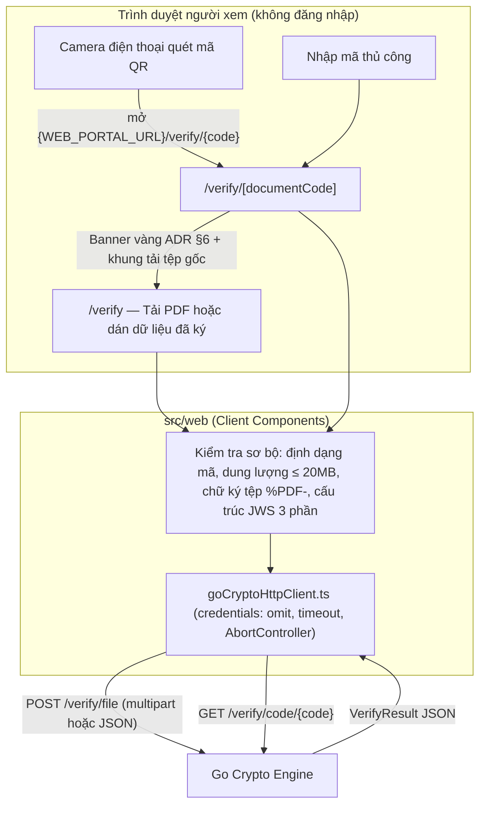

# KẾ HOẠCH TRIỂN KHAI (IMPLEMENTATION PLAN)
## PHASE 3 — BƯỚC 3.2 / 4: PHÂN HỆ CÔNG KHAI `(public)` — CỔNG KIỂM TRA VĂN BẢN

---

## 1. Metadata
* **Mã Kế Hoạch (Related Issue ID):** `PLAN-2026-11-21-WEB-PHASE3-STEP2-PUBLIC`
* **File Kế Hoạch:** `docs/plans/active/2026-11-21-web-phase3-step2-public-verification.md`
* **Trạng Thái (Status):** `COMPLETED` *(Đã hoàn thành & nghiệm thu)*
* **Phạm Vi Tác Động (Affected Layers):**
  - `src/web/` — Phân hệ `(public)`: `/verify` và `/verify/[documentCode]`, HTTP client gọi Go Crypto Engine, từ điển `verify` (`vi`/`en`).
  - `src/crypto-engine/` — *(Chỉ khi được duyệt ở mục 2)*: sửa URL nhúng trong mã QR, chuẩn hóa 2 mã lỗi chưa đăng ký.
* **Không tác động tới:** `src/management/`, PostgreSQL Schema Migrations.

---

## 2. Bối Cảnh, Phát Hiện Khi Khảo Sát & Câu Hỏi Cần Chốt

### 2.1. Mục tiêu
Cho phép **bất kỳ ai, không cần đăng nhập** kiểm tra một văn bản QuickSign theo 2 cách:
1. **Tải tệp lên** (`/verify`): tệp PDF đã ký hoặc dữ liệu điện tử đã ký (chuỗi JWS) → gọi `POST /api/v1/verify/file` để kiểm tra chữ ký và đối chiếu dấu vân tay của tệp.
2. **Quét mã QR in trên văn bản** (`/verify/[documentCode]`) → gọi `GET /api/v1/verify/code/{documentCode}`. Theo **ADR 0001 §6**, trang **bắt buộc** hiện banner cảnh báo màu vàng và khung tải tệp gốc ngay bên dưới để người xem kiểm tra nội dung.

### 2.2. Phát hiện khi khảo sát mã nguồn

> [!WARNING]
> **Mã QR đang trỏ sai đích (vô hiệu hóa ADR 0001 §6).**
> `signing_service.go` đang sinh URL QR theo dạng `{APP_BASE_URL}/api/v1/verify/code/{code}`, trong đó `APP_BASE_URL` trỏ về **chính Go Engine**. Khi quét bằng điện thoại, người xem chỉ thấy JSON thô, không có cảnh báo màu vàng và không có ô tải tệp gốc.
> **Đề xuất:** Đổi biến cấu hình `APP_BASE_URL` thành `WEB_PORTAL_URL` (trỏ về Web Portal) và sinh URL QR theo dạng `{WEB_PORTAL_URL}/verify/{code}`.

> [!WARNING]
> **Go trả về 2 mã lỗi chưa đăng ký trong `docs/error_codes.md` (vi phạm `AGENT.md` §3).**
> `verify_handler.go` và `sign_handler.go` đang trả `INVALID_ARGUMENT` (400) và `INTERNAL_ERROR` (500).
> **Đề xuất:** Thay bằng 2 mã đã đăng ký là `INVALID_PAYLOAD` và `INTERNAL_SERVER_ERROR`.

> [!IMPORTANT]
> **Trang tra mã QR phải gọi API trực tiếp từ trình duyệt (Client-side), không qua SSR.**
> Go ghi nhận IP và User-Agent của người xem để chống spam bộ đếm (`unique_verify_count`, khóa Redis 10 phút). Nếu gọi qua máy chủ Next.js, mọi lượt xem sẽ mang cùng một IP, khiến số liệu thống kê sai và cơ chế chống spam mất tác dụng.

### 2.3. Câu hỏi cần chốt (Open Questions)
1. **Sửa phía Go (2 mục WARNING ở trên)**: Bạn có đồng ý gộp 2 thay đổi nhỏ trong `src/crypto-engine` vào bước này không? *(Khuyến nghị: **Đồng ý**. Nếu không sửa URL QR thì trang `/verify/[documentCode]` không bao giờ được mở từ mã QR thật.)*
2. **Trang chủ `/`**: Hiện `/` tự chuyển sang `/login` hoặc `/overview`. *(Khuyến nghị: **Giữ nguyên** ở bước này, chỉ thêm liên kết "Kiểm tra văn bản" vào khung đăng nhập/đăng ký và đầu trang công khai. Trang giới thiệu (landing) sẽ làm sau.)*
3. **Quét QR bằng camera ngay trong trình duyệt**: *(Khuyến nghị: **Chưa làm**. Mã QR chứa sẵn đường dẫn, nên ứng dụng camera mặc định của điện thoại đã mở thẳng `/verify/{code}`. Việc dùng `BarcodeDetector` chưa được hỗ trợ đồng đều trên Safari và Firefox.)*
4. **Giới hạn dung lượng tệp**: Đặc tả API ghi tối đa 20 MB, còn mã Go đang chấp nhận tới 25 MB. *(Khuyến nghị: Frontend chặn ở **20 MB** theo đặc tả.)*

---

## 3. Architecture Impact (Thành Phần Tạo Mới / Thay Đổi)

### 3.1. Luồng tổng thể

### 3.2. `src/web` — Tầng HTTP & Service
* `[NEW]` `src/services/http/api-error.ts`: Tách `UnifiedApiError`, `ApiClientError` ra file dùng chung cho cả 2 client.
* `[MODIFY]` `src/services/http/dotnetHttpClient.ts`: Import `ApiClientError` từ `api-error.ts` (không đổi hành vi).
* `[NEW]` `src/services/http/goCryptoHttpClient.ts`: Gọi `NEXT_PUBLIC_GO_CRYPTO_API_URL`.
  - `credentials: "omit"` và **không gửi `Authorization`**: lượt kiểm tra công khai luôn ẩn danh.
  - `cache: "no-store"`, timeout 30 giây (`AbortSignal.any([callerSignal, AbortSignal.timeout(30_000)])`).
  - Chuẩn hóa lỗi mạng thành `NETWORK_ERROR` và lỗi timeout thành `SERVICE_UNAVAILABLE`.
* `[NEW]` `src/services/crypto.service.ts`: `verifyPdfFile(file, signal)`, `verifyJwsToken(token, signal)`, `lookupDocumentCode(code, signal)`. Mã văn bản luôn được bọc bằng `encodeURIComponent`.

### 3.3. `src/web` — Module `features/verification`
* `[NEW]` `types/verification.types.ts`: `VerifyResult`, `ValidationStatus` (union 6 trạng thái khớp `domain.VerifyResult` của Go).
* `[NEW]` `utils/document-code.ts`: `normalizeDocumentCode()` (trim + chữ in hoa) và `isValidDocumentCode()` (regex `^DOC-\d{4}-[0-9A-F]{8}$`). Mã sai định dạng bị chặn ngay, không gọi API.
* `[NEW]` `utils/file-guard.ts`: `MAX_VERIFY_FILE_BYTES = 20 MB`, `inspectPdfFile(file)` đọc 5 byte đầu (`file.slice(0, 5)`) để xác nhận chữ ký `%PDF-` trước khi tải lên.
* `[NEW]` `utils/jws-input.ts`: `extractJwsToken(text)` nhận chuỗi JWS thô, JSON dạng `{ "jws": "..." }` hoặc nguyên kết quả trả về từ `/sign/json`, sau đó kiểm tra đủ 3 phần base64url.
* `[NEW]` `utils/verification-view-model.ts`: Chuyển `ValidationStatus` thành `{ tone: "valid" | "warning" | "danger" | "neutral", i18nKey, icon }` và hàm `detectCodeMismatch(expectedCode, result)` (tệp tải lên thuộc văn bản khác với mã QR).
* `[NEW]` `hooks/use-verification.ts`: Máy trạng thái `idle → checking → done | error`, hủy request cũ khi gửi request mới hoặc khi rời trang, chống bấm gửi 2 lần.
* `[NEW]` Components:
  - `public-header.tsx`: Logo, nút đổi ngôn ngữ, liên kết Đăng nhập.
  - `verify-mode-tabs.tsx`: 2 tab "Văn bản PDF" / "Dữ liệu điện tử" (`role="tablist"`, điều hướng bằng phím mũi tên, vùng chạm ≥ 44px).
  - `pdf-dropzone.tsx`: `<label>` bọc `<input type="file" accept="application/pdf">` để mở trình chọn tệp (và camera) trên điện thoại, hỗ trợ kéo-thả trên máy tính và thao tác hoàn toàn bằng bàn phím.
  - `jws-input-panel.tsx`: `<textarea>` dán chuỗi, kèm nút mở tệp `.txt`/`.json` (đọc ngay trên trình duyệt bằng `file.text()`).
  - `document-code-form.tsx`: Ô nhập mã thủ công, điều hướng sang `/verify/{code}`.
  - `verification-result-card.tsx`: Thẻ kết quả gồm trạng thái, người ký và thời điểm ký. Thông tin kỹ thuật (mã văn bản, dấu vân tay SHA-256) được thu gọn trong `
` kèm nút sao chép (`AGENT.md` §4.1 Progressive Disclosure).
  - `security-notice-banner.tsx`: Banner vàng ADR §6, có `role="status"`.
* `[NEW]` `src/components/ui/copy-button.tsx`: Nút sao chép dùng chung (`navigator.clipboard.writeText`, có phản hồi "Đã sao chép").

### 3.4. `src/web` — App Router, i18n, Giao diện chung
* `[NEW]` `src/app/(public)/layout.tsx`: Khung trang công khai (Mobile-First, dùng `PublicHeader`).
* `[NEW]` `src/app/(public)/verify/page.tsx`: Trang kiểm tra bằng tệp, kèm ô nhập mã.
* `[NEW]` `src/app/(public)/verify/[documentCode]/page.tsx`: Server wrapper chỉ đọc `params` (Promise trong Next 15), đặt metadata `robots: { index: false }` để không lập chỉ mục mã văn bản, và render Client Component `QrLookupView` để gọi API **từ trình duyệt**.
* `[NEW]` `src/locales/vi/verify.json` & `src/locales/en/verify.json`: Toàn bộ chữ của phân hệ (6 trạng thái, banner ADR §6, thông báo kiểm tra sơ bộ, nhãn), viết bằng ngôn ngữ đời thường.
* `[MODIFY]` `src/i18n/types.ts` & `src/i18n/language-context.tsx`: Thêm namespace `verify`.
* `[MOVE]` `src/features/auth/utils/auth-error-mapper.ts` → `src/i18n/map-error-message.ts` (`mapErrorMessage`) dùng chung cho `auth` và `verification`. Cập nhật import và đổi tên test tương ứng (xóa file cũ theo Zero Dead Code).
* `[MODIFY]` `src/styles/ui.styles.ts`: Thêm `dropzone`, `tabs`, `resultCard` (3 tông màu Emerald/Amber/Crimson), `detailsDrawer`, `publicHeader`.
* `[MODIFY]` `src/app/(auth)/layout.tsx`: Thêm liên kết "Kiểm tra văn bản" dẫn tới `/verify`.

### 3.5. `src/crypto-engine` *(chỉ khi Câu hỏi 1 được duyệt)*
* `[MODIFY]` `internal/config/config.go`: Thay `AppBaseURL`/`APP_BASE_URL` bằng `WebPortalURL`/`WEB_PORTAL_URL`.
* `[MODIFY]` `internal/core/services/signing_service.go`: `qrUrl = fmt.Sprintf("%s/verify/%s", webPortalURL, url.PathEscape(docCode))`.
* `[MODIFY]` `cmd/server/main.go`: Truyền `cfg.WebPortalURL`.
* `[MODIFY]` `.env.example`: Đổi biến thành `WEB_PORTAL_URL` (dùng placeholder). Báo người dùng tự cập nhật file `.env` cục bộ.
* `[MODIFY]` `internal/adapters/inbound/http/verify_handler.go`, `sign_handler.go`: `INVALID_ARGUMENT` → `INVALID_PAYLOAD`, `INTERNAL_ERROR` → `INTERNAL_SERVER_ERROR`.
* `[MODIFY]` `tests/unit/signing_service_test.go`: `MockPdfCryptoPort` lưu lại `qrUrl` để kiểm tra URL QR trỏ về `/verify/{code}` của Web Portal.
* `[MODIFY]` `tests/integration/http_signing_verification_integration_test.go`: Cập nhật tham số khởi tạo `SigningService`.

---

## 4. Error Codes Impact
* **Không thêm mã lỗi backend mới.**
* Go chỉ còn phát ra các mã **đã đăng ký** trong `docs/error_codes.md`: `INVALID_PAYLOAD`, `INTERNAL_SERVER_ERROR`, `DOCUMENT_NOT_FOUND`, `SERVICE_UNAVAILABLE`, `RATE_LIMIT_EXCEEDED`.
* `ValidationStatus` (`VALID`, `TAMPERED_CONTENT`, `CERT_REVOKED`, `CERT_EXPIRED_AT_SIGNING`, `UNKNOWN_SIGNATURE`, `CODE_EXISTS_UNVERIFIED_CONTENT`) là **kết quả kiểm tra**, không phải mã lỗi, nên được dịch trong `locales/{vi,en}/verify.json`.
* Frontend **không hiển thị** `message` hay `verificationWarning` do backend trả về; mọi câu chữ đều lấy từ từ điển i18n (`AGENT.md` §3).
* Các thông báo kiểm tra sơ bộ phía client (`FILE_TOO_LARGE`, `NOT_A_PDF`, `INVALID_JWS_FORMAT`, `INVALID_DOCUMENT_CODE`) chỉ tồn tại ở frontend, được đặt trong `verify.json`, không đăng ký vào registry backend.

---

## 5. Performance, Security & Background Offloading
* **Gọi trực tiếp từ trình duyệt tới Go**, không qua proxy Next.js: tránh đệm tệp 20 MB hai lần và giữ đúng IP/User-Agent cho bộ đếm và chống spam.
* **Kiểm tra sơ bộ phía client** (dung lượng, 5 byte đầu `%PDF-`, cấu trúc JWS, regex mã văn bản): loại bỏ request vô ích trước khi tải lên.
* **Hủy request** bằng `AbortController` khi gửi lại hoặc rời trang; khóa nút gửi khi đang xử lý.
* **Ẩn danh & riêng tư:** không gửi cookie/Bearer khi kiểm tra công khai; trang `/verify/[code]` đặt `noindex`; không lưu tệp ở trình duyệt sau khi có kết quả.
* **Chống nhầm văn bản:** khi người xem tải tệp từ trang mã QR, nếu `documentCode` của tệp khác mã QR thì hiện cảnh báo đỏ "Tệp này không khớp với mã trên văn bản".
* **Background Offloading:** Không phát sinh tác vụ nền mới ở bước này. *(Ghi nhận nợ kỹ thuật: Go hiện ghi `verification_logs` đồng bộ; theo `AGENT.md` §5.1 cần chuyển sang Worker Pool. Đề xuất xử lý trong một kế hoạch riêng cho `src/crypto-engine`.)*

---

## 6. Execution Checklist

- [x] **Bước 1:** Kiểm tra quy chuẩn thiết kế & truy cập (Mobile-first, `role="tablist"`, `
`, nút chạm $\ge 44\text{px}$).
- [x] **Bước 2:** Sửa Go: `WEB_PORTAL_URL`, URL QR `/verify/{code}`, chuẩn hóa 2 mã lỗi `INVALID_PAYLOAD` / `INTERNAL_SERVER_ERROR`, cập nhật test; chạy `go vet ./...` và `go test ./...`.
- [x] **Bước 3:** Tách `api-error.ts`, tạo `goCryptoHttpClient.ts`, `crypto.service.ts`; chuyển `auth-error-mapper.ts` thành `i18n/map-error-message.ts`.
- [x] **Bước 4:** Tạo `features/verification/{types,utils,hooks}`.
- [x] **Bước 5:** Thêm `locales/{vi,en}/verify.json`, mở rộng `i18n/types.ts` và `language-context.tsx`; bổ sung preset vào `ui.styles.ts`.
- [x] **Bước 6:** Tạo UI components (`copy-button`, `public-header`, `verify-mode-tabs`, `pdf-dropzone`, `jws-input-panel`, `document-code-form`, `verification-result-card`, `security-notice-banner`, `qr-lookup-view`).
- [x] **Bước 7:** Tạo routes `(public)/layout.tsx`, `/verify`, `/verify/[documentCode]`; thêm liên kết "Kiểm tra văn bản" trong `(auth)/layout.tsx`.
- [x] **Bước 8:** Viết Vitest cho `document-code`, `file-guard`, `jws-input`, `verification-view-model`, `goCryptoHttpClient`, `map-error-message`.
- [x] **Bước 9:** Nghiệm thu: `npm run typecheck`, `npm run test`, `npm run build` (kèm Lint), `go vet ./...`, `go test ./...`; đánh dấu `[x]`, chuyển kế hoạch sang `docs/plans/archived/`, cập nhật `walkthrough.md`.

---

## 7. Test Verification Matrix

| Nhóm | Kịch bản | Kết quả kỳ vọng |
| :--- | :--- | :--- |
| **Happy Path** | Tải PDF đã ký hợp lệ tại `/verify` | Thẻ xanh "Văn bản nguyên vẹn", hiện người ký, thời điểm ký; dấu vân tay nằm trong mục thu gọn |
| **Happy Path** | Dán chuỗi JWS hợp lệ (hoặc JSON `{ "jws": ... }`) | `extractJwsToken` tách đúng token; kết quả `VALID` |
| **Happy Path** | Mở `/verify/{code}` hợp lệ | Gọi API từ trình duyệt; banner vàng ADR §6 kèm khung tải tệp gốc |
| **Happy Path** | Đổi ngôn ngữ `VI` ↔ `EN` trên 2 trang công khai | Toàn bộ chữ đổi ngay, không thiếu khóa (TypeScript bảo đảm) |
| **Edge / Boundary** | Tệp 20 MB + 1 byte / tệp đổi đuôi `.pdf` nhưng không bắt đầu bằng `%PDF-` | Chặn ở client, hiện thông báo dễ hiểu, không gửi request |
| **Edge / Boundary** | Mã nhập `doc-2026-6ab19fd9 ` (chữ thường, có khoảng trắng) | Chuẩn hóa thành `DOC-2026-6AB19FD9` và tra cứu thành công |
| **Edge / Boundary** | Mã sai định dạng / chứa ký tự `../` | Không gọi API, hiện "Mã văn bản không đúng định dạng" |
| **Edge / Boundary** | Bấm "Kiểm tra" liên tục / rời trang khi đang tải | Chỉ request mới nhất có hiệu lực; request cũ bị hủy, không cập nhật state sau khi rời trang |
| **Security / Failure** | Tệp PDF bị sửa 1 ký tự sau khi ký | Thẻ đỏ "Văn bản đã bị chỉnh sửa" (`TAMPERED_CONTENT`) |
| **Security / Failure** | Tải tệp có `documentCode` khác mã QR đang xem | Cảnh báo đỏ "Tệp này không khớp với mã trên văn bản" |
| **Security / Failure** | Mã không tồn tại (`DOCUMENT_NOT_FOUND`) / Go tắt (`NETWORK_ERROR`) / timeout | Thông báo tự nhiên theo `vi`/`en`, không lộ mã lỗi thô hay stack trace |
| **Security / Failure** | Kiểm tra request trong DevTools | Không có header `Authorization`, không gửi cookie; trang mã có `noindex` |
| **Go (nếu sửa)** | `SignPdf` sinh URL QR | URL có dạng `{WEB_PORTAL_URL}/verify/{code}`; Go không còn phát ra `INVALID_ARGUMENT`/`INTERNAL_ERROR` |
