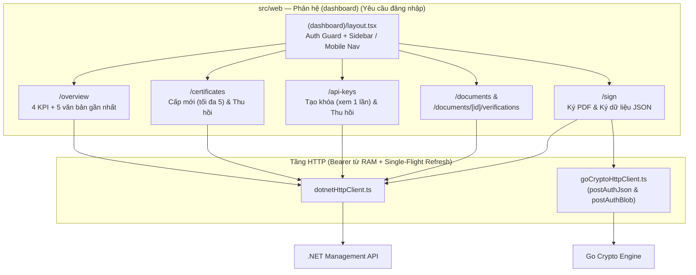

# KẾ HOẠCH TRIỂN KHAI (IMPLEMENTATION PLAN)
## PHASE 3 — BƯỚC 3.3 / 4: PHÂN HỆ BẢNG ĐIỀU KHIỂN NGƯỜI DÙNG `(dashboard)`

---

## 1. Metadata
* **Mã Kế Hoạch (Related Issue ID):** `PLAN-2026-11-21-WEB-PHASE3-STEP3-DASHBOARD`
* **File Kế Hoạch:** `docs/plans/active/2026-11-21-web-phase3-step3-dashboard.md`
* **Trạng Thái (Status):** `COMPLETED` *(Đã hoàn thành & nghiệm thu)*
* **Phạm Vi Tác Động (Affected Layers):**
  - `src/web/` — Toàn bộ phân hệ `(dashboard)` (`/overview`, `/sign`, `/certificates`, `/api-keys`, `/documents`, `/documents/[id]/verifications`), các service gọi `.NET` & `Go` có xác thực Bearer JWT, các UI primitive mới (`modal-dialog.tsx`, `empty-state.tsx`), từ điển `dashboard` (`vi`/`en`), và unit tests (Vitest).
* **Không tác động tới:** `src/management/`, `src/crypto-engine/`, PostgreSQL Schema Migrations.

---

## 2. Mục Tiêu & Bối Cảnh

Hoàn thiện không gian làm việc chính cho người dùng đã đăng nhập trên **QuickSign Web Portal (`src/web`)**, kết nối trực tiếp tới cả 2 dịch vụ Backend:
* **.NET Management Service**: Quản lý thống kê cá nhân (`/stats/overview`), vòng đời chứng thư số (`/certificates`), khóa kết nối (`/api-keys`), và hồ sơ văn bản + nhật ký kiểm tra (`/documents`).
* **Go Crypto Engine**: Thực hiện ký văn bản PDF (`/sign/pdf` — trả binary PDF kèm `X-Document-Code`) và ký dữ liệu điện tử JSON (`/sign/json`).

### Quy chuẩn tuân thủ (`AGENT.md` & `.agents/skills`)
1. **Bảo mật Token In-Memory**: Mọi request ký số tới Go và quản lý tới `.NET` đều lấy `access_token` thuần từ RAM (`token-memory.ts`); khi nhận `401`, dùng chung cơ chế **Single-Flight Refresh** (`/api/auth/refresh`) trước khi retry.
2. **Hiển thị Khóa kết nối 1 lần duy nhất**: `plaintextApiKey` chỉ giữ tạm trong state của hộp thoại kết quả tạo khóa và bị xóa sạch ngay khi người dùng đóng hộp thoại.
3. **Ngôn ngữ tự nhiên, không lặp từ, không máy móc (`AGENT.md` §4.4)**: Toàn bộ nhãn, mô tả, trạng thái rỗng và xác nhận đều tách vào `src/locales/{vi,en}/dashboard.json` (100% không hardcode trong JSX).
4. **Tách biệt giao diện Tailwind tập trung**: Bổ sung các preset cho Sidebar, Navigation, KPI Cards, Data Table / Mobile Summary Cards, và Native `<dialog>` Modal vào `src/styles/ui.styles.ts`.
5. **Mobile-First & Progressive Disclosure (`AGENT.md` §4.1, §4.3)**: Nút chạm $\ge 44 \times 44\text{px}$; trên mobile thay bảng rộng bằng thẻ tóm tắt xếp dọc; thông số kỹ thuật (mã sê-ri, khóa công khai PEM, dấu vân tay SHA-256) đặt gọn trong `
`.

---

## 3. Architecture Impact (Thành Phần Tạo Mới / Thay Đổi)

### 3.1. Luồng giao tiếp phân hệ `(dashboard)`

### 3.2. Tầng HTTP & Services (`src/web/src/services/`)
* `[MODIFY]` `src/services/http/goCryptoHttpClient.ts`:
  - Bổ sung `postAuthenticatedJson<T>()` và `postAuthenticatedBlob()` đính kèm `Authorization: Bearer <token>` từ `tokenMemory` và tự động gọi `refreshAccessTokenSingleFlight()` khi nhận `401` (1 lần retry).
  - Với `postAuthenticatedBlob()`: đọc `Blob`, `X-Document-Code` và phân tích `filename` từ header `Content-Disposition`.
* `[MODIFY]` `src/services/crypto.service.ts`: Bổ sung `signPdf(input)` và `signJson(input)`.
* `[NEW]` `src/services/statistics.service.ts`: `getMyOverview()`.
* `[NEW]` `src/services/certificate.service.ts`: `getMyCertificates()`, `getById(id)`, `issueCertificate(input)`, `revokeCertificate(id, input)`.
* `[NEW]` `src/services/api-key.service.ts`: `getMyApiKeys()`, `createApiKey(input)`, `revokeApiKey(id)`.
* `[NEW]` `src/services/document.service.ts`: `getMyDocuments(skipCount, maxResultCount)`, `getById(id)`, `getVerificationHistory(id, skipCount, maxResultCount)`.

### 3.3. UI Primitives Dùng Chung (`src/web/src/components/ui/`)
* `[NEW]` `modal-dialog.tsx`: Component hộp thoại dùng thẻ `<dialog>` nguyên bản (`showModal()`), hỗ trợ đóng bằng phím `Escape` hoặc bấm nền ngoài, có vùng chạm nút đóng $\ge 44 \times 44\text{px}$.
* `[NEW]` `empty-state.tsx`: Khối hiển thị trạng thái chưa có dữ liệu kèm nút hành động chính.

### 3.4. Modules Nghiệp Vụ (`src/web/src/features/*`)
* **`features/statistics/`**:
  - `types/statistics.types.ts` (`DashboardOverviewStatsDto`).
  - `components/overview-dashboard.tsx`: Bố cục **F-Pattern** (4 Headline KPIs ở trên, hạn mức chứng thư + 5 văn bản ký gần nhất bên dưới).
* **`features/signing/`**:
  - `types/signing.types.ts` (`SignPdfInput`, `SignPdfResult`, `SignJsonResponse`).
  - `utils/filename-parser.ts`: Hàm bóc tách tên tệp an toàn từ `Content-Disposition` và fallback `<tên>_signed.pdf`.
  - `components/signing-studio.tsx`: 2 tab **Ký văn bản PDF** (chọn chứng thư Active, lý do, địa điểm, kéo-thả PDF $\le 20\text{ MB}$, tự động tải tệp đã ký + hiện mã văn bản & link kiểm tra) và **Ký dữ liệu điện tử** (nhập hoặc nạp mẫu JSON, hiển thị chuỗi đã ký kèm nút sao chép / tải `.json`).
* **`features/certificates/`**:
  - `types/certificate.types.ts` (`KeyAlgorithmType`: `1=Rsa2048`, `2=EcdsaP256`; `CertificateStatusType`: `1=Active`, `2=Expired`, `3=Revoked`; `CertificateResponseDto`, `IssueCertificateRequestDto`, `RevokeCertificateRequestDto`).
  - `components/certificates-manager.tsx`: Thanh hạn mức `X / 5`, modal cấp chứng thư mới, danh sách thẻ chứng thư (chi tiết sê-ri & khóa công khai nằm trong `
`), modal thu hồi chọn thời điểm hết hiệu lực (`invalidatedFrom`) & lý do.
* **`features/api-keys/`**:
  - `types/api-key.types.ts` (`ApiKeyItemDto`, `CreateApiKeyRequestDto`, `ApiKeyCreatedResponseDto`).
  - `components/api-keys-manager.tsx`: Danh sách khóa (chỉ hiện `keyPrefix`), modal tạo khóa mới (tích chọn quyền `sign` / `verify`, ngày hết hạn tùy chọn), **Modal hiển thị khóa 1 lần duy nhất** (xóa sạch khỏi state khi đóng), modal xác nhận thu hồi khóa.
* **`features/documents/`**:
  - `types/document.types.ts` (`DocumentType`: `1=Pdf`, `2=Json`; `VerificationMethodType`: `1=WebUpload`, `2=WebCode`, `3=Api`; `ValidationStatusType`: `1..6`; `SignedDocumentDto`, `VerificationLogDto`).
  - `components/documents-list.tsx`: Bảng trên desktop (`md:`), thẻ tóm tắt xếp dọc trên mobile, phân trang `skipCount`/`maxResultCount`, cảnh báo đỏ khi `tamperedAlertCount > 0`.
  - `components/document-verifications-view.tsx`: Thông tin tóm lược văn bản + dòng thời gian toàn bộ lượt kiểm tra.

### 3.5. App Router, i18n & Tailwind Styles
* `[NEW]` `src/app/(dashboard)/layout.tsx`: Auth Guard + Sidebar Desktop + Thanh điều hướng Mobile + nút Đăng xuất + nút đổi ngôn ngữ.
* `[MODIFY]` `src/app/(dashboard)/overview/page.tsx`: Thay shell Bước 3.1 bằng `OverviewDashboard`.
* `[NEW]` `src/app/(dashboard)/sign/page.tsx`
* `[NEW]` `src/app/(dashboard)/certificates/page.tsx`
* `[NEW]` `src/app/(dashboard)/api-keys/page.tsx`
* `[NEW]` `src/app/(dashboard)/documents/page.tsx`
* `[NEW]` `src/app/(dashboard)/documents/[id]/verifications/page.tsx`
* `[NEW]` `src/locales/vi/dashboard.json` & `src/locales/en/dashboard.json`
* `[MODIFY]` `src/i18n/types.ts` & `src/i18n/language-context.tsx`: Thêm namespace `dashboard`.
* `[MODIFY]` `src/styles/ui.styles.ts`: Thêm preset cho `sidebar`, `kpiCard`, `table`, `modal`, `progressBar`.

---

## 4. Error Codes Impact
* **Không thêm mã lỗi backend mới.**
* Tận dụng toàn bộ bảng mã lỗi đã đồng bộ sẵn trong `src/web/src/locales/{vi,en}/errors.json` (`MAX_ACTIVE_CERTS_REACHED`, `CERT_ALREADY_REVOKED`, `INVALID_REVOCATION_TIMESTAMP`, `CERT_NOT_FOUND`, `CERT_REVOKED_AT_SIGNING`, `CERT_EXPIRED_AT_SIGNING`, `INVALID_PDF_FORMAT`, `INVALID_JSON_PAYLOAD`, `SIGNING_FAILED`, `API_KEY_NOT_FOUND`, `DOCUMENT_NOT_FOUND`, `FORBIDDEN_ACCESS`).

---

## 5. Performance, Security & Background Offloading
* **Tải song song dữ liệu (`/overview`, `/documents/[id]/verifications`)**: Dùng `Promise.all` giảm thời gian chờ tải trang.
* **Giải phóng Blob URL (`URL.revokeObjectURL`)**: Ngay sau khi kích hoạt tải tệp PDF đã ký xuống máy, giải phóng object URL để tránh rò rỉ bộ nhớ trình duyệt.
* **Zero Plaintext Key Retention**: Xóa ngay `plaintextApiKey` khỏi state khi người dùng đóng hộp thoại tạo API Key.
* **Background Offloading**: Không phát sinh tác vụ nền backend mới ở bước Frontend này.

---

## 6. Execution Checklist

- [x] **Bước 1:** Mở rộng `goCryptoHttpClient.ts` (Bearer + Single-Flight Refresh + Blob download) và tạo các service (`statistics`, `certificate`, `api-key`, `document`, bổ sung `crypto.service.ts`).
- [x] **Bước 2:** Bổ sung `locales/{vi,en}/dashboard.json`, cập nhật `i18n/types.ts`, `language-context.tsx` và preset mới trong `src/styles/ui.styles.ts`.
- [x] **Bước 3:** Tạo UI Primitives (`modal-dialog.tsx`, `empty-state.tsx`) và khung điều hướng `(dashboard)/layout.tsx`.
- [x] **Bước 4:** Triển khai `features/statistics` & nâng cấp `/overview`.
- [x] **Bước 5:** Triển khai `features/certificates` & trang `/certificates`.
- [x] **Bước 6:** Triển khai `features/api-keys` & trang `/api-keys`.
- [x] **Bước 7:** Triển khai `features/signing` & trang `/sign`.
- [x] **Bước 8:** Triển khai `features/documents` & 2 trang `/documents`, `/documents/[id]/verifications`.
- [x] **Bước 9:** Viết Vitest cho `goCryptoHttpClient` (authenticated retry & blob header parsing).
- [x] **Bước 10:** Nghiệm thu toàn diện (`npm run typecheck`, `npm run test`, `npm run build`), đánh dấu `[x]`, chuyển plan sang `docs/plans/archived/`, cập nhật `walkthrough.md`.

---

## 7. Test Verification Matrix

| Nhóm | Kịch Bản Kiểm Thử | Kết Quả Kỳ Vọng |
| :--- | :--- | :--- |
| **Happy Path** | Mở `/overview` sau đăng nhập | Hiển thị 4 KPI từ `/stats/overview` và 5 văn bản ký gần nhất |
| **Happy Path** | Cấp chứng thư mới tại `/certificates` | Gọi `POST /certificates`, cập nhật danh sách và thanh hạn mức `X / 5` |
| **Happy Path** | Ký PDF tại `/sign` | Gọi `POST /sign/pdf` kèm Bearer, tự tải `<tên>_signed.pdf`, hiển thị `X-Document-Code` và link `/verify/{code}` |
| **Happy Path** | Ký JSON tại `/sign` | Gọi `POST /sign/json`, hiển thị chuỗi đã ký kèm nút sao chép / tải tệp |
| **Happy Path** | Tạo API Key tại `/api-keys` | Modal hiển thị `plaintextApiKey` 1 lần; đóng modal là xóa khỏi state, danh sách chỉ hiện `keyPrefix` |
| **Happy Path** | Xem danh sách `/documents` & lịch sử `/documents/[id]/verifications` | Phân trang mượt, hiển thị đúng số lượt kiểm tra & nhật ký chi tiết |
| **Edge / Boundary** | Đạt 5/5 chứng thư Active | Nút cấp mới bị vô hiệu hóa kèm giải thích rõ ràng |
| **Edge / Boundary** | Ký khi chưa có chứng thư Active | Hiện trạng thái rỗng lịch sự kèm nút đi tới `/certificates` |
| **Edge / Boundary** | Xem trên màn hình mobile (`375px`) | Bảng văn bản/nhật ký tự chuyển sang Summary Cards, không tràn ngang |
| **Security / Failure** | `access_token` hết hạn đúng lúc bấm Ký PDF | `goCryptoHttpClient` tự gọi `/api/auth/refresh` (Single-Flight) và thực hiện lại lệnh ký |
| **Security / Failure** | Truy cập `/overview` hoặc `/sign` khi chưa đăng nhập | `(dashboard)/layout.tsx` chuyển hướng về `/login` |
